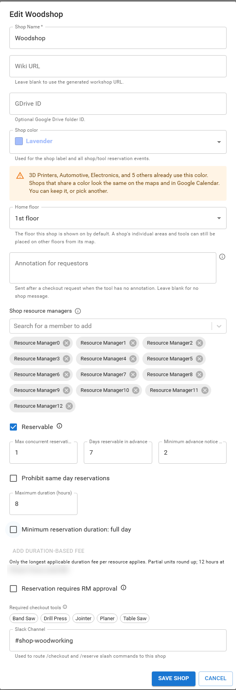
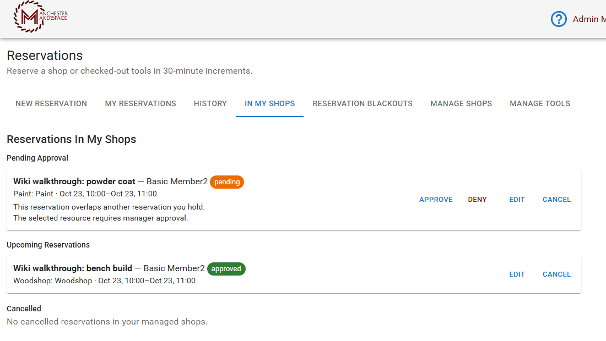
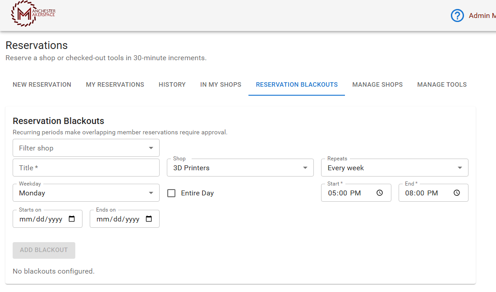

# Manage Reservations

Resource Managers (RMs) manage reservations for their own shops. Admins and board members manage every shop. This page covers the extra screens you get, how to set a shop or tool up so it can be reserved, and how to approve requests. For what members do, see [Reserve a Shop or Tool](/digital-makerspace/members/reserve-a-shop-or-tool).

## The extra tabs

On the **Reservations** page you see more tabs than members do:

| Tab | What it is for |
| --- | --- |
| **New Reservation** | Also offers **Create on behalf of another member**. |
| **In My Shops** | The approval queue and every upcoming and cancelled booking in the shops you manage. |
| **Reservation Blackouts** | Recurring times when bookings need approval. |
| **Manage Shops** | The shop list, with each shop's reservation settings. |
| **Manage Tools** | The tool list, with each tool's reservation settings. |

## Set up a shop or tool for reservations

A shop or tool can be reserved only after you turn it on.

1. Open **Manage Shops** (or **Manage Tools**) on the Reservations page. You can also use **Tool Checkouts**, then **Shops** or **Tools**.
2. Tick the shop or tool and choose **Edit**.
3. Tick **Reservable**. More settings appear.
4. Set them, then choose **Save Shop** or **Save Tool**.

{width=450px}

| Setting | What it does | Usual default |
| --- | --- | --- |
| **Max concurrent reservations** | How many bookings can overlap. | 1 |
| **Days reservable in advance** | How far ahead members can book. | 7 |
| **Minimum advance notice (hours)** | How far ahead a booking must start. | 2 |
| **Prohibit same day reservations** | Blocks bookings that start today. | Off |
| **Maximum duration (hours)** | The longest booking, in half hours. | 8 |
| **Minimum reservation duration: full day** | Makes bookings whole days, in date steps. | Off |
| **Add duration-based fee** | Charges for longer bookings, using an item from **Shop Fees**. Only the longest applicable fee per resource applies, and partial units round up. | None |
| **Reservation requires RM approval** | New bookings wait for approval. | Off |
| **Required checkout tools** | The checkouts a member needs to reserve. A tool always requires a checkout on itself. | None for a shop |

The **Slack Channel** on a shop is how **/reserve** finds the shop. Set it as in [Add and Manage Tools and Shops](/digital-makerspace/resource-managers/tools-and-shops). Tools can also be set to **Mark out of service**, which blocks new reservations for them.

Settings changes affect new and edited bookings. They do not cancel bookings that already exist. You cannot delete a shop or tool that has future bookings.

## Approve or deny requests

Open **In My Shops**. **Pending Approval** lists bookings waiting on you, with the reason each one needs approval.

- **Approve** confirms it at once. It moves to **Upcoming Reservations**.
- **Deny** rejects it.
- **Edit** and **Cancel** change or remove a booking.

{width=700px}

The member is told the result by Slack message. You cannot approve your own reservation. A reservation also needs approval when it overlaps one the member already holds, or falls in a blackout.

## Reservation blackouts

Use **Reservation Blackouts** for recurring times that should not be freely booked, such as a class or maintenance window. A booking that overlaps a blackout does not get blocked. It becomes pending, so you decide.

Fill in a **Title**, the **Shop**, how it **Repeats** (for example every week), the **Weekday**, the **Start** and **End** times or **Entire Day**, and optional **Starts on** and **Ends on** dates. Choose **Add Blackout**.

{width=700px}

## Slack and calendar

- **/reserve** works in each shop's linked Slack channel.
- The portal keeps two read-only canvases per shop, **Today's … Reservations** and **Tomorrow's … Reservations**. A channel manager adds each one to the channel header once, with the **+** button in Slack. After that they update on their own.
- Reservation events are shown on the shop's Google Calendar, in the shop's color.
- If the canvases look out of date, an admin can rebuild them: open **Portal Settings**, choose **Jobs**, find **Reservation Canvas Rebuild**, and choose **Run Now**.

## Daily Slack summaries and empty invitations

Each day from 7 AM Eastern, configured channels receive one dated summary of approved, pending and unpaid reservations beginning that day. Tool reservations use the tool's **Users Channel**, falling back to the shop channel only when undefined. Whole-shop bookings go to the shop and all its configured tool-users channels. Shared channels do not repeat the same booking. Edits and cancellations update the original message.

Every message includes **Live today agenda** links and **Reserve [shop]** buttons. Tool-users channel members can read the linked shop canvas. The link follows the rolling live agenda, even from an older message. The agenda includes overnight carryovers and refreshes when those bookings change, even if the summary stays unchanged or the shop only has a tool Users Channel. The Reserve button checks the clicking member's linked account and eligibility.

In **Edit Shop**, **Announce empty reservation agendas in Slack** controls free-agenda invitations for that shop and its tools. It starts off and is separate from whole-shop **Reservable**. Assigned RMs, admins and board members can change it. Invitations appear only in empty channels, counting bookings that carry over from yesterday, blackouts and availability. Switching it off removes invitation text from today's existing message. Marking a tool hidden or out of service also removes its invitation on an update, while retaining any existing booked rows for review. A previously posted summary that becomes empty can remain as **No reservations to announce for [date]**.

Before posting today's new summary, the portal tries to remove yesterday's post in the same channel if its last message was an empty invitation or neutral empty summary. Summaries that listed reservations stay in Slack. A failed cleanup does not prevent today's message.

An admin can use **Portal Settings → Jobs → Daily Reservation Announcements → Run Now** to recover a summary after 7 AM. A failure can mean Slack could not post, edit, or share its canvas. Ask an admin to check the job status and channel configuration; do not repeatedly delete summaries.

## Troubleshooting

| Problem | What to check |
| --- | --- |
| A shop is missing from members' list | **Reservable** is not ticked, or the shop is hidden. |
| A tool is missing from a member's list | The member is not checked out on it, or the tool is not reservable or is out of service. |
| Everything needs approval | **Reservation requires RM approval** is on, or a blackout covers that time. |
| Members cannot book far enough ahead | Raise **Days reservable in advance**. |
| **/reserve** says there is no shop for the channel | The shop's **Slack Channel** is empty or wrong. |
| The Slack canvas is stale | Run **Reservation Canvas Rebuild**. |

*Last reviewed: October 2026*
